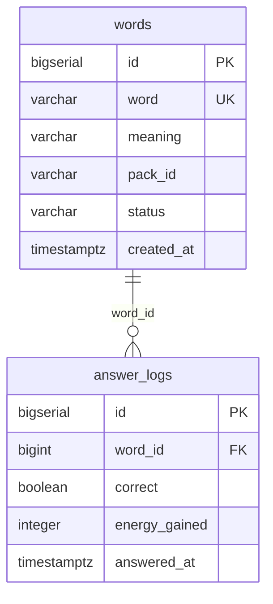

# data-model.md — 英语变强 RPG 数据模型

> 本文件是第 3 周数据库的「设计图纸」：两张表存什么、字段怎么定、靠哪个字段关联。
> 创建于 Day 16（2026-10-12）。建表与种子数据（`db/schema.sql`、`db/seed.sql`）均以本文件为准。

## 0. 环境

| 项 | 值 |
|---|---|
| CloudBase 环境 ID | `zry-environment-d3f82wzy2947f766` |
| 数据库 | PostgreSQL（PG 模式，控制台 → SQL 数据库 → SQL 编辑器执行 SQL） |
| 建模思路 | 教材统一模式：**一张主对象表 + 一张按时间累积的记录表**，靠一个字段关联 |

## 1. 两张表分别存什么

| 表 | 角色 | 存什么 | 数据量预期 |
|---|---|---|---|
| `words` | 主对象 | 要学的**单词**：拼写、释义、属于哪个词包、掌握状态 | 少而稳定（几十~几百行），随词包扩充缓慢增长 |
| `answer_logs` | 按时间累积的记录 | 每一次**答题行为**：答了哪个词、对不对、得了多少体力、什么时候答的 | 每答一题多一行，无限增长 |

**关联字段：`answer_logs.word_id` → `words.id`**，一对多（一个单词对应多条答题记录）。

## 2. 字段明细与选型理由

### 2.1 words（单词 · 主对象）

| 字段 | 类型 | 约束 | 含义 | 为什么这么选 |
|---|---|---|---|---|
| `id` | `bigserial` | PRIMARY KEY | 自增主键 | PG 惯用的自增整数键；`bigserial` 比 `serial` 容量大，一劳永逸 |
| `word` | `varchar(64)` | NOT NULL **UNIQUE** | 单词拼写 | 加 UNIQUE 是关键：它是这行的**业务键**，种子脚本重复执行时靠它「已存在就跳过」，实现幂等 |
| `meaning` | `varchar(255)` | NOT NULL | 中文释义 | 255 够放短语级释义 |
| `pack_id` | `varchar(32)` | NOT NULL | 词包标识（`daily` / `travel`） | 直接沿用 `words.js` 里 WORD_PACKS 的 id，前端词包分组不用改 |
| `status` | `varchar(16)` | NOT NULL DEFAULT `'todo'`，CHECK 限定 `todo/doing/done` | 掌握状态 | 对应 `mock-data.js` 的 `STATUS_TEXT`（未开始/学习中/已掌握），Day 20 前端切换时字段含义零翻译成本 |
| `created_at` | `timestamptz` | NOT NULL DEFAULT `now()` | 入库时间 | 用 `timestamptz`（带时区）而不是 `timestamp`，避免服务器/本地时区不一致造成的 8 小时偏差 |

### 2.2 answer_logs（答题记录 · 记录表）

| 字段 | 类型 | 约束 | 含义 | 为什么这么选 |
|---|---|---|---|---|
| `id` | `bigserial` | PRIMARY KEY | 自增主键 | 同上 |
| `word_id` | `bigint` | NOT NULL，**FOREIGN KEY → words(id)** | 这条记录答的是哪个词 | **两张表的关联字段**。用 id 关联而不用单词文本：以后改单词拼写/释义，历史记录不断；整数 join 也比文本快 |
| `correct` | `boolean` | NOT NULL | 对 / 错 | 布尔比 `0/1` 语义清晰，PG 原生支持 |
| `energy_gained` | `integer` | NOT NULL DEFAULT `0`，CHECK ≥ 0 | 本次答题获得的体力 | 支撑 PRD「学英语获得体力」；放在记录里而不是累计到 words，记录保持「不可变的事实」，统计随时可重算 |
| `answered_at` | `timestamptz` | NOT NULL DEFAULT `now()` | 答题时间 | Day 19 周榜按周聚合就靠它 |

> 记录表刻意**不存**答对率、累计分这类「算出来的数」——它们都能从 answer_logs 现算（答对率 = SUM(correct)/COUNT，累计分 = SUM(energy_gained)），存了反而会出现「账实不符」。

## 3. 与接口契约的对应（为什么这两张表够用）

| 接口（api-contract.md 登记） | 用到什么 |
|---|---|
| Day 17 读接口（GET 单词列表 / 答题记录） | 直接查 `words`；查 `answer_logs` 时 join `words` 取单词拼写 |
| Day 18 `POST /api/answer` | 判定后往 `answer_logs` 插一行，顺带更新 `words.status` |
| Day 19 `GET /api/rank/weekly` | 按 `answered_at` 所在周聚合 `answer_logs` |
| Day 19–20 `GET /api/titles` | 基于答题统计（连续答对、累计答对数）判解锁 |

战斗分数（`POST /api/score`，Day 18）暂无落库表——**今天不建第三张表**，按任务边界 Day 18 前再登记设计。

## 4. 变更记录

| 日期 | 变更 |
|---|---|
| 2026-10-12 | Day 16 创建：定稿 `words` / `answer_logs` 两表结构与关联字段 `word_id` |
